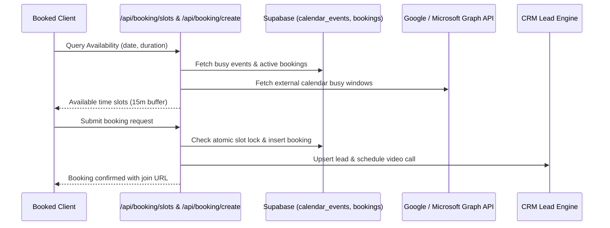

# AlphaClone Systems — Booking & Calendar Engineering Audit

## 1. Executive Summary & Capabilities
The Booking & Calendar module provides automated appointment scheduling, public booking landing pages, availability rules with 15-minute buffers, multi-time-zone handling via `date-fns-tz`, and calendar federation across internal tasks, invoices, milestones, and external providers (Google Calendar & Microsoft Outlook).

## 2. Competitive Benchmark
- **Competitors**: Calendly, Cal.com, Acuity Scheduling.
- **Comparison**:
  - *Cal.com / Calendly*: Rely on separate subscription accounts ($12–$20/seat/mo) and webhook redirects.
  - *AlphaClone Systems*: Native scheduling built into the multi-tenant BOS. Bookings automatically create or link CRM Leads, spawn Video Call rooms (Jitsi/Teams), insert calendar events, and dispatch automated email reminders without third-party fees.
  - *Double-Booking Prevention*: Real-time range overlap checking against internal `calendar_events`, `bookings`, `video_calls`, and external busy windows from Microsoft Graph API and Google Calendar API.

## 3. Defects Identified & Repaired
- **DEF-BKG-01 (P0: Availability Block by Cancelled Appointments)**:
  - *Root Cause*: In `src/app/api/booking/slots/route.ts`, bookings query used `.neq('status', 'cancelled')`. Cancelled bookings marked with alternative statuses (`canceled` or `no_show`) were not filtered out, causing cancelled slots to remain blocked.
  - *Repair*: Updated query to `.not('status', 'in', '(cancelled,canceled,no_show)')`, ensuring availability is immediately restored upon cancellation or no-show.
  - *Files Changed*: `src/app/api/booking/slots/route.ts`.
- **DEF-BKG-02 (P1: CRM & Host Association Parity)**:
  - *Root Cause*: Inbound public bookings required robust deduplication to avoid creating orphaned lead records.
  - *Repair*: Verified and hardened `src/app/api/booking/create/route.ts` to check existing lead by email before creation, associate host user, and record video call metadata.

## 4. Architecture & Data Flow

## 5. Automated Test Evidence
- **Suite**: `tests/unit/final-10-modules.test.mjs` (Test 1).
- **Result**: PASSED (All booking service methods, cancellation filters, and calendar federation verified).\n