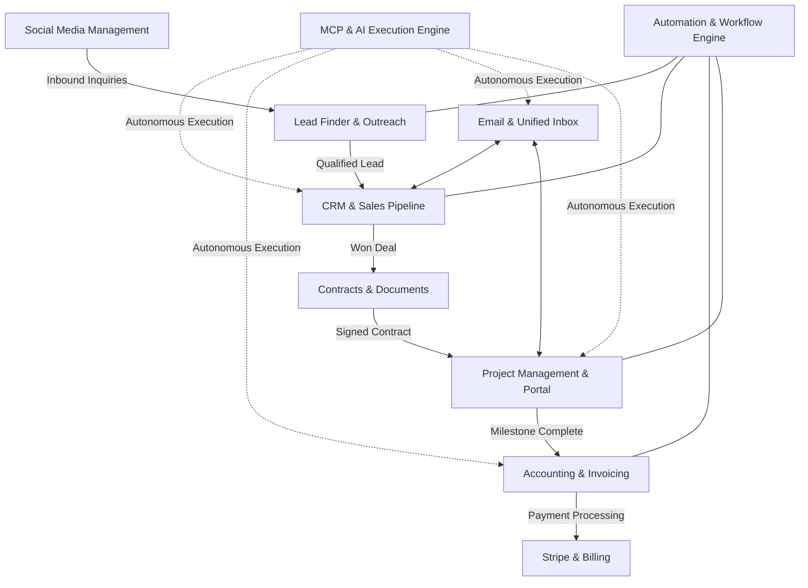

# AlphaClone Systems — Cross-Module Architecture & Data Flow

## 1. Architectural Overview
AlphaClone Systems unifies 10 core business modules into an autonomous operating system. Data flows seamlessly between marketing, sales, contracts, project fulfillment, accounting, and client communications.

## 2. Key Lifecycle Data Transitions
1. **Lead to Deal**:
   - Outbound campaign replies or Lead Finder queries identify high-intent prospects.
   - Deduped and normalized into CRM Contacts and Organizations.
   - Deal created in `lead` stage.
2. **Deal to Contract**:
   - On advancement to `proposal` / `negotiation`, a contract draft is generated.
   - Shorthand tokens (`{{client_name}}`, `{{project_scope}}`, `{{total}}`) are resolved from CRM data.
   - E-signature invitation dispatched via Zoho Mail / Resend.
3. **Contract to Project**:
   - Webhook / signature verification marks contract `signed`.
   - Automatically provisions Project with predefined deliverables, stages, and timeline.
   - Client Portal access granted to client signers.
4. **Project to Invoice**:
   - Milestone completion triggers invoice generation.
   - Invoice generated via PDF generator and sent to client with Stripe checkout link.
   - Payment webhook transitions invoice to `paid` and records revenue in accounting ledger.

## 3. Global Consistency & Security Invariants
- **Multi-Tenant Isolation**: Every database record includes an immutable `tenant_id` governed by PostgreSQL RLS.
- **Design System Consistency**: Untitled UI charcoal dark palette (`#0e1015` background, `#12151c` cards, `#171b24` borders) maintained across all dashboard views.
- **No Synthetic Hallucination**: Metrics calculations return `null` or `0` when records are absent; never invent fake performance numbers.\n