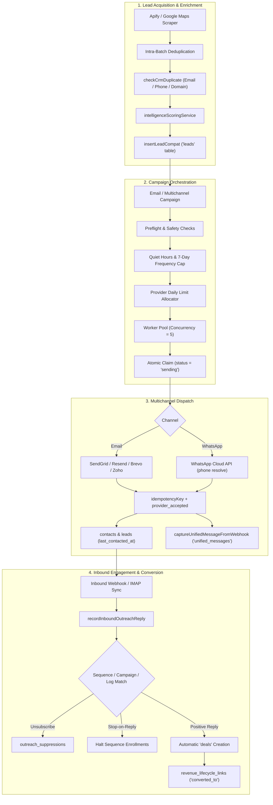
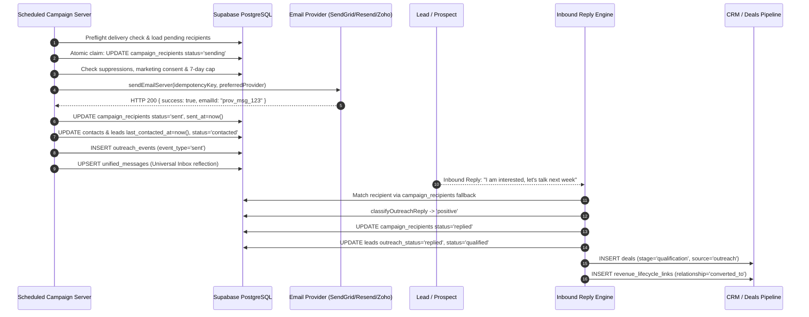

# ALPHACLONE SYSTEMS — OUTBOUND ARCHITECTURE MAP
**End-to-End System Topology, Data Flow & Interaction Architecture**

---

## 1. System Topology Overview

AlphaClone Systems' sales engagement architecture is built on a unified event-driven engine connecting data discovery pipelines with customer relationship management and multichannel delivery providers.

---

## 2. Execution Sequence: Campaign Send to Opportunity Creation

---

## 3. Database Schema Interconnections

1. **`leads`**:
   - Stores prospective companies, websites, phones, emails, intelligence scores, and `outreach_status`.
   - Linked to `contacts` via `contact_id` and `business_clients` via `client_id`.
2. **`campaign_recipients`**:
   - Represents individualized delivery units. Holds `status` (`pending`, `sending`, `sent`, `failed`, `replied`), `metadata.abVariant`, and `provider_message_id`.
3. **`unified_messages`**:
   - Canonical real-time omnichannel message storage powering `AlphaCloneEmailWorkspace.tsx`.
4. **`outreach_events`**:
   - Immutable audit trail of dispatch events, webhook receipts, open pixels, click redirects, and classification outcomes.
5. **`deals` & `revenue_lifecycle_links`**:
   - Connects qualified outbound interest directly into the revenue conversion engine.
