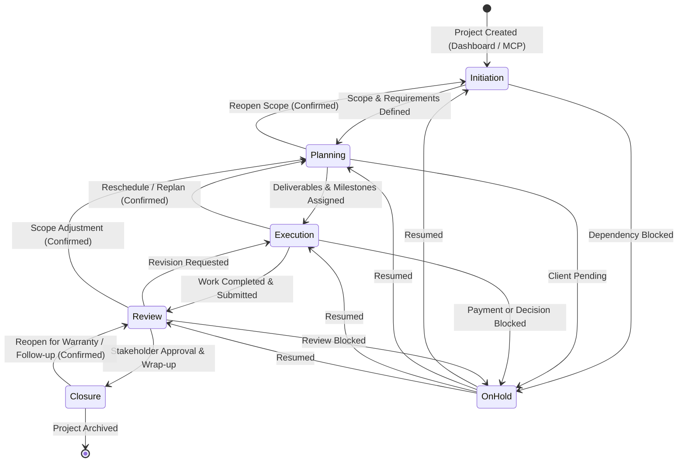
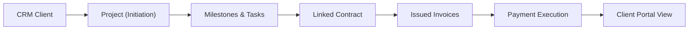

# AlphaClone Systems — Project Lifecycle Map

## 1. Unified Project Lifecycle State Machine

This document defines the authoritative, single state model governing projects across the AlphaClone Systems platform, spanning the Dashboard, MCP Tools, Domain Services, Database, Outbox Workers, and Client Portal.



---

## 2. Canonical Stage vs. Operational Status Matrix

The codebase strictly distinguishes between **Lifecycle Stage** (where the project is in its delivery journey) and **Operational Status** (the executive state of execution).

| Lifecycle Stage | Order | Canonical Label | Allowed Next Stages | Operational Status | Default Progress |
| :--- | :--- | :--- | :--- | :--- | :--- |
| **Initiation** | 1 | Step 1/5 | Planning, On Hold | `Active` / `Pending` | 0% – 20% |
| **Planning** | 2 | Step 2/5 | Execution, Initiation, On Hold | `Active` | 20% – 40% |
| **Execution** | 3 | Step 3/5 | Review, Planning, On Hold | `Active` / `in_progress` | 40% – 80% |
| **Review** | 4 | Step 4/5 | Closure, Execution, On Hold | `Active` / `review` | 80% – 95% |
| **Closure** | 5 | Step 5/5 | Review, Execution (Reopened) | `Completed` / `done` | 100% |
| **On Hold** | 0 | Paused | Any previous stage | `On Hold` / `Pending` | Preserved |

---

## 3. Transition Requirements & Validation Guardrails

Enforced by `src/services/projectStageService.ts` (`validateTransition`):

```typescript
const PROJECT_STAGES: Record<string, ProjectStage> = {
    'Initiation': {
        name: 'Initiation',
        order: 1,
        requiredFields: ['name', 'description'],
        nextStages: ['Planning', 'Execution', 'Review', 'Closure', 'On Hold'],
        previousStages: [],
    },
    'Planning': {
        name: 'Planning',
        order: 2,
        requiredFields: ['name', 'description'],
        nextStages: ['Execution', 'Review', 'Closure', 'On Hold'],
        previousStages: ['Initiation'],
    },
    'Execution': {
        name: 'Execution',
        order: 3,
        requiredFields: ['name', 'description'],
        nextStages: ['Review', 'Closure', 'On Hold'],
        previousStages: ['Planning', 'Initiation'],
    },
    'Review': {
        name: 'Review',
        order: 4,
        requiredFields: ['name', 'description'],
        nextStages: ['Closure', 'On Hold'],
        previousStages: ['Execution', 'Planning', 'Initiation'],
    },
    'Closure': {
        name: 'Closure',
        order: 5,
        requiredFields: ['name'],
        nextStages: ['Initiation', 'Planning', 'Execution', 'Review'],
        previousStages: ['Review', 'Execution', 'Planning', 'Initiation'],
    },
    'On Hold': {
        name: 'On Hold',
        order: 0,
        requiredFields: ['name', 'hold_reason'],
        nextStages: ['Initiation', 'Planning', 'Execution', 'Review', 'Closure'],
        previousStages: ['Initiation', 'Planning', 'Execution', 'Review', 'Closure'],
    },
};
```

### Transition Guardrail Rules
1. **Forward Transitions**: Allowed automatically when all required fields for the target stage are non-empty.
2. **Missing Requirements**: Blocked with structured feedback detailing missing field names and the exact drawer tab where they can be resolved.
3. **Backward Transitions**: Allowed with explicit user confirmation (`requiresConfirmation: true`).
4. **Closure Transition**: Marks operational status as `Completed`, sets progress to 100%, writes `estimated_completion_date`, and enqueues completion notifications.
5. **Reopening from Closure**: Moving away from `Closure` automatically restores operational status to `Active` and recalculates progress based on live tasks and milestones.

---

## 4. End-to-End Client Lifecycle Integration



1. **Client Association**: When a project is created with a `clientId`, `portal_enabled` is automatically activated, a cryptographic `portal_token` is generated, and `metadata.client_visible` is set to `true`.
2. **Milestones & Tasks**: Milestones mutate atomically via `mutateProjectMilestone`, trigger native calendar sync, recompute project progress, log to `workspace_activity`, and queue client email notifications.
3. **Invoices & Contracts**: Contracts and invoices linked to the project (`contract_id`, `project_id`) are scoped to the authenticated client, allowing one-click preview, signing, and checkout.
4. **Outbox Synchronization**: All lifecycle events are enqueued to `project_notification_outbox` with durable idempotency keys and exponential backoff retry policies.
